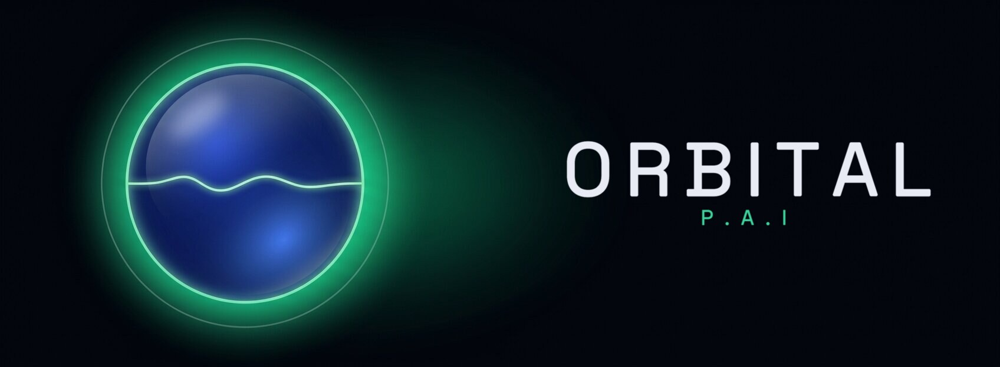
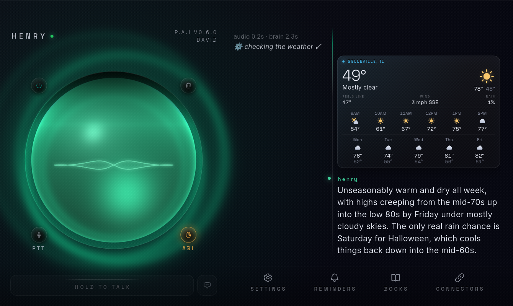
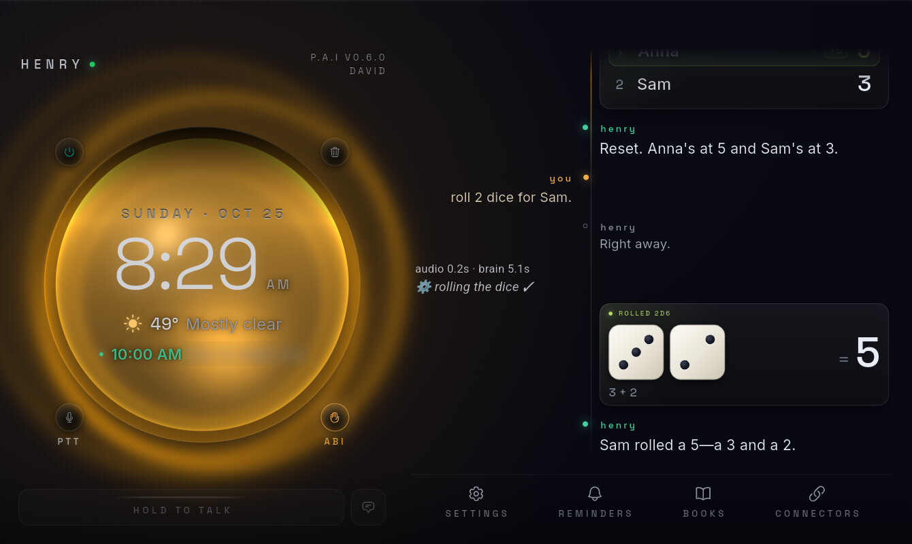
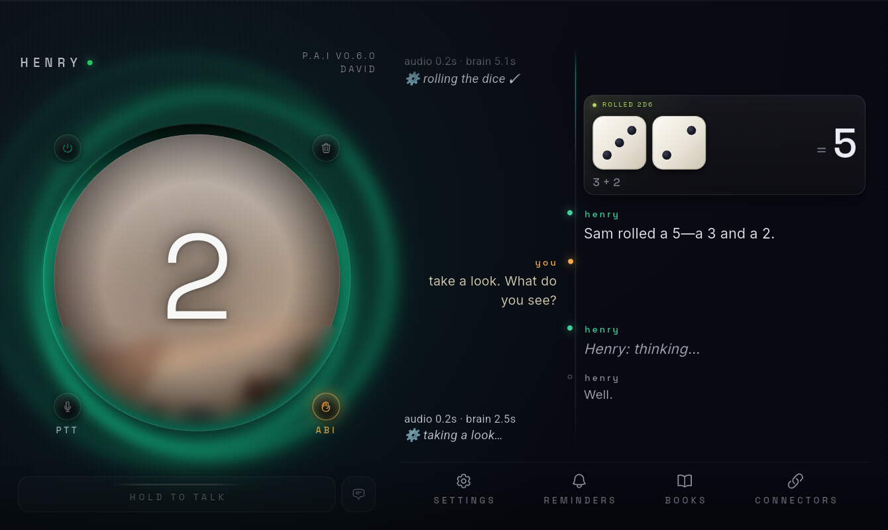
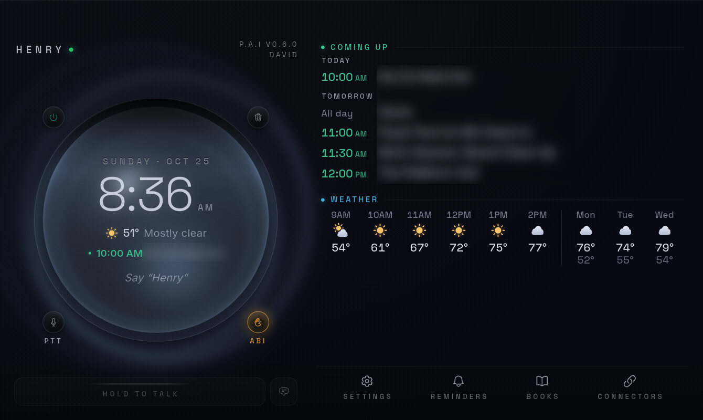

<div align="center">



[](https://elixir-lang.org/)
[](https://www.phoenixframework.org/)
[](https://flutter.dev/)
[](https://github.com/)

</div>

---

> [!WARNING]
> **Hold onto your hats!** 🎢
> This project is under **heavy, active development**. Expect sudden breaking changes, plenty of bugs, and a bit of a rollercoaster ride in the short term while the dust settles. Use at your own risk!

# Orbital P.A.I — a naturally-responsive voice assistant

Orbital (I named mine **Henry**) is a low-latency, voice-first personal assistant. You say "Henry",
you talk, and it answers out loud, fast. It can actually *do things*: your calendar and email,
reminders and timers, the lights and the music, lists and recipes, even looking at what you hold up
to the camera. It remembers what matters about you across conversations.

The brain is an **Elixir/Phoenix** server. You talk to it through a **Flutter** app: on your phone,
or on a tablet that lives on the wall as the household's Henry. The web is the admin dashboard.

## Screenshots

The wall tablet, in landscape:

| Henry speaking | Game night |
|---|---|
|  |  |
| **"Henry, look at this"** | **Today, at rest** |
|  |  |

The orb is the light source. It glows **amber** while you speak and **green** while Henry speaks,
and a line moves across the glass with his voice. At rest it's a clock with the weather and your
next event. After a couple of quiet minutes the conversation gives way to a **Today** board.

## What Henry can do

- **Talk naturally.** Hands-free with the "Henry" wake word (spotted on the device; no audio leaves
  it until it hears its name), or push-to-talk. Interrupt him mid-sentence and he stops. Pause to
  think and he waits.
- **Answer fast.** An instant "reflex" line masks the wait while the "brain" streams the real answer,
  word by word, into speech and onto the screen.
- **Do things, with cards to show for it:** weather, reminders, timers (with an alarm on the device),
  Google **Calendar** and **Gmail**, web search, lists, a garden log, trackers, routines and
  recipes (with a step-by-step cook mode), and a household intercom.
- **Run the house** through **Home Assistant**: lights, scenes and media players, by the names you
  use. Locks, alarms and garage doors are view-only on purpose.
- **See.** "Henry, what am I holding?" turns the orb into a viewfinder, takes one photo, and answers
  about it. The photo is never stored.
- **Game night.** Dice ("roll 2d6", "d20"), coin flips, "pick who goes first", and a running
  scoreboard, each as a big card on the wall.
- **Remember.** Durable profile facts and a rolling summary, searchable memory over your mail and
  calendar, all visible and editable.
- **Speak up on his own.** Reminders, timers, calendar heads-ups, rain alerts and an optional morning
  briefing, timed so he doesn't talk over you.
- **Live on the wall.** A tablet becomes a wall display: screen held on, no system bars, readable
  across the room, dimmed at night. Marked as **shared**, it's the household's: "remind me" there
  goes to everyone.
- **Hand work to Claude.** "Henry, have Claude look at issue 42" dispatches a coding agent to work a
  repo issue and open a pull request, then tells you when it's done (optional; see `docs/`).
- **Two-user ready.** Sign-in goes through your identity provider (Authentik/OIDC) and an allowlist;
  each person sees only their own memory, reminders and accounts.

## How it works

```
app: wake word (on device) → mic ──► Phoenix channel ──► Cartesia Ink-2 STT → Conversation (gen_statem)
                                                              ├─► reflex  (instant filler, Gemini)
                                                              └─► brain   (streaming Gemini → Cartesia Sonic TTS → app)
                                                                     └─ tools · toolkits (home, repos) · cards
```

- **One vendor for voice:** Cartesia **Ink-2** for speech-to-text (semantic turn detection, so a
  thinking pause doesn't end your turn) and **Sonic** for text-to-speech.
- **Gemini** for the reflex, the brain and the vision call; tools run inline mid-turn and return
  cards the app draws.
- **The app** (`native/`) owns the microphone, the wake word, echo cancellation and playback. The
  server owns everything else.

## Run it (dev)

Needs Elixir/Erlang (versions in `.tool-versions`), Node (asset deps), Flutter for the app, and API
keys.

```bash
cd server
cp .env.example .env     # GOOGLE_API_KEY, CARTESIA_API_KEY, the OIDC_* sign-in settings,
                         # and ALLOWED_USERS (the sign-in allowlist: set it to your own account)
mix setup                # deps, DB, assets
cd .. && ./dev.sh        # runs the server on PORT (8787), tees to server/log/companion.log

cd native && ./run-dev.sh --local   # the app on an attached Android device, pointed at your Mac
```

Optional: `docker compose -f docker-compose.dev.yml up -d` starts Qdrant (semantic memory). Without
it the server still runs.

- **Secrets and config** live in `.env` (gitignored). Never commit them.
- **Google Calendar / Gmail** need your *own* Google Cloud project; see
  **[docs/connectors.md](docs/connectors.md)**. **Home Assistant** needs `HOME_ASSISTANT_URL` and a
  token.
- `native/README.md` covers the app's build scripts (`run-dev.sh`, `run-profile.sh`, `run-build.sh`).

## Deploy

The server ships as a Docker image behind any reverse proxy or tunnel that supports WebSockets (e.g.
a Cloudflare Tunnel). Secrets and the host come from environment variables; nothing is baked into
the image. See `docker-compose.yml` and **[docs/deploy-coolify.md](docs/deploy-coolify.md)** for a
reference deployment (SQLite on a persistent volume).

## Project layout

A monorepo: **`server/`** (Phoenix: the brain, tools, memory, channels and the admin dashboard) and
**`native/`** (one Flutter project: Android phone and tablet today; desktop and iOS later).

- `server/lib/app/conversations/`: the turn engine (`Conversation`, `Policy`, `BrainStream`).
- `server/lib/app/adapters/`: Cartesia STT/TTS and Gemini.
- `server/lib/app/tools/` and `toolkits/`: what the brain can call, and the kits it opens per turn.
- `server/lib/app_web/`: the voice and panel channels, and the dashboard.
- `native/lib/voice/`, `audio/`, `meridian/`: the controller, the audio path and the UI.
- `docs/architecture.md`: the longer tour.

## Cloud LLM vs Local LLMs

This project leans on a handful of paid API keys: Gemini (the LLM), Cartesia (speech-to-text and
text-to-speech) and Voyage (embeddings). They cost money, but they get the infrastructure out of the
way so I can focus on building features and iterate quickly.

It's not all cloud, though: the wake word runs on the device, and the speaker verifier behind Voice
Lock is a small ONNX model that runs in-process on the server's CPU. The long-term goal is to bring
the heavier pieces local too, especially the LLMs, which would cut costs dramatically.

I don't have enough usage data yet to give a monthly cost estimate with current APIs.

## Contributing

Contributions are welcome: see [CONTRIBUTING.md](CONTRIBUTING.md) for setup, the test gates
(`mix precommit`; `flutter test` and `flutter analyze`), and conventions. Framework idioms live in
`AGENTS.md`.

## License

[MIT](LICENSE) © David Clausen
